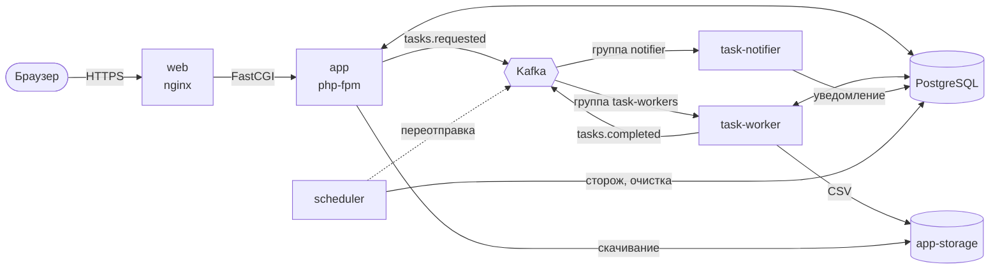
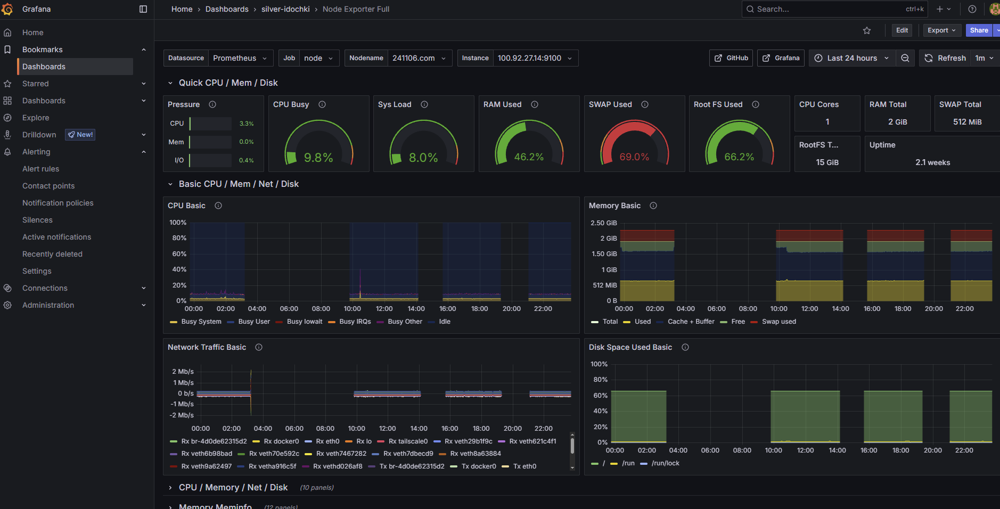
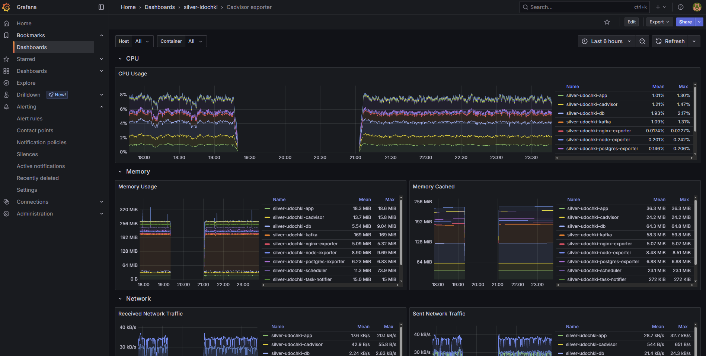
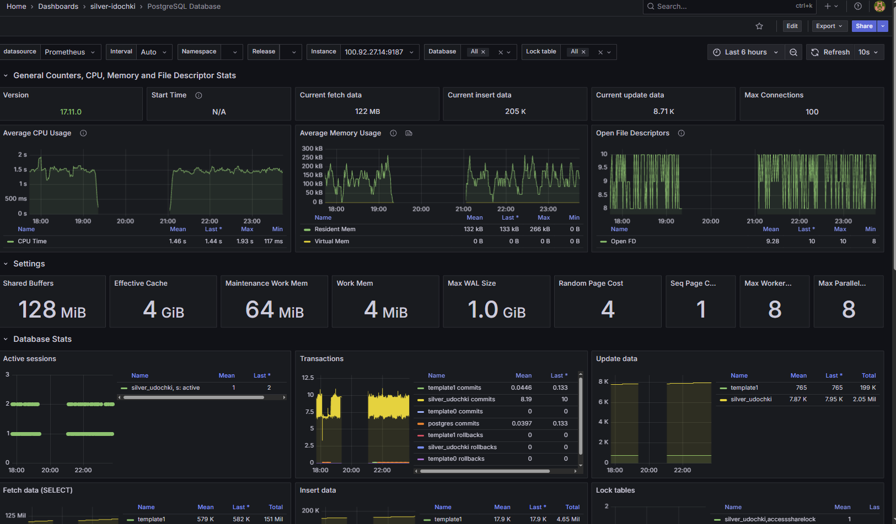
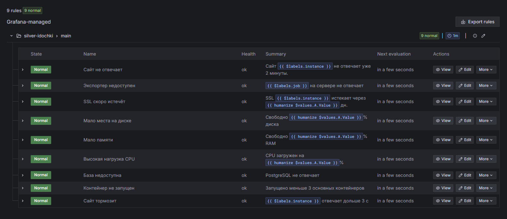
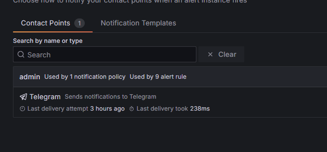
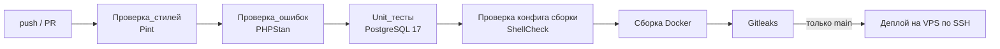

<div align="center">

# 🎣 Silver Udochki

**Интернет-магазин для любителей охоты и рыбалки**

[](https://github.com/byterID/Silver-Udochki/actions/workflows/ci.yml)


[Сайт](https://silver-udochki.ru) · [Архитектура](#-архитектура) · [Быстрый старт](#-быстрый-старт) · [Мониторинг](#-мониторинг) · [CI/CD](#-cicd) · [Документация](https://github.com/byterID/Silver-Udochki/tree/orphan/docs)

</div>

---
## Стек

| Слой | Технологии |
|---|---|
| Бэкенд | PHP 8.4 (FPM), Laravel 13, spatie/laravel-permission |
| Фронтенд | Blade, Tailwind CSS, Alpine.js, Vite |
| Данные | PostgreSQL 17 |
| События | Apache Kafka 4.1 (KRaft), `mateusjunges/laravel-kafka` + `ext-rdkafka` |
| Инфраструктура | Docker Compose, nginx, Certbot, Ansible, Tailscale |
| Мониторинг | Prometheus, Grafana, node-exporter, cAdvisor, postgres-exporter, nginx-exporter |
| Качество | Pint, PHPStan (Larastan), PHPUnit, ShellCheck, Gitleaks, GitHub Actions |

## Схема архитектуры



Подробности технической реализации — в [документации](https://github.com/byterID/Silver-Udochki/tree/orphan/docs).

## Быстрый запуск

Нужны Docker с Docker Compose v2 и Git (на Windows команды `sh` запускаются из Git Bash или WSL).

```bash
git clone https://github.com/byterID/Silver-Udochki.git
cd Silver-Udochki
cp .env.example .env
```

В `.env` заполнить `DB_PASSWORD`, `ADMIN_EMAIL`, `ADMIN_PASSWORD` и `APP_KEY`.

```bash
docker compose run --rm --no-deps app php artisan key:generate --show
```

Запуск локально

```bash
docker compose -f docker-compose.yml -f compose.local.yml up -d --build
sh docker/kafka/create-topics.sh
docker compose exec app php artisan migrate --seed
```

Сайт откроется на <http://127.0.0.1:8080>, вход — `ADMIN_EMAIL` и `ADMIN_PASSWORD` из `.env`.

Проверить, что фоновые задачи работают:

```bash
docker compose exec app php artisan tasks:demo --seconds=5
docker compose logs -f task-worker task-notifier
```

Успешный тест: через несколько секунд задача перейдёт в статус Готово, в колокольчике появится уведомление.

## Как устроен мониторинг

Prometheus и Grafana работают на локальной виртуальной машине и снимают метрики с сервера по Tailscale ip адресу.(поэтому на скриншотах видны "падения". компьютер уходил в сон.)
На самом сервере запущены только экспортеры. Алерты настроены, уведомления приходят в Telegram-бота.







Весь стек кушает около 1–1,3 ГБ памяти, поэтому на сервере с 2 ГБ RAM включён swap.

## Схема CI/CD




---

<div align="center">
<sub>Pet-проект для изучения инфраструктуры современных веб-систем 🐟</sub>
</div>
