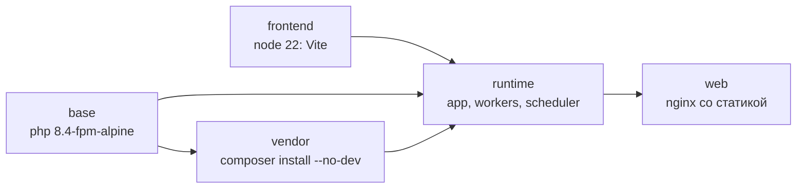

# 🏗 Архитектура

Общая схема сервисов — в [README основной ветки](https://github.com/byterID/Silver-Udochki#схема-архитектуры).
Здесь — состав, сборка и принципы устройства кода.

## Сервисы

| Сервис | Назначение | Лимит памяти |
|---|---|---|
| `web` | nginx: TLS, статика, проксирование в php-fpm | — |
| `app` | Laravel, HTTP-запросы (`www-data`) | — |
| `db` | PostgreSQL 17 | — |
| `kafka` | брокер и контроллер в одном узле, KRaft | 700 МБ |
| `kafka-init` | один раз выставляет права на том `kafka-data` и завершается | — |
| `task-worker` | `tasks:consume` — выполняет задачи | 256 МБ |
| `task-notifier` | `tasks:notify` — создаёт уведомления | 128 МБ |
| `scheduler` | `schedule:work` — сторож и очистка | 128 МБ |

Все сервисы работают с `no-new-privileges`, логи ротируются (3 файла по 10 МБ).
Тома: `db-data`, `kafka-data` и `app-storage` — общий для `app`, `web` (только чтение), `task-worker` и `scheduler`,
через него скачиваются результаты задач.

## Файлы compose

| Файл | Назначение |
|---|---|
| `docker-compose.yml` | основной стек: nginx с HTTPS (80/443, сертификаты из `docker/certbot`), Kafka, воркеры |
| `compose.local.yml` | локально: сайт на `127.0.0.1:8080` без TLS; всегда указывается вместе с основным |
| `docker-compose.monitoring.yml` | экспортеры, слушают только Tailscale-адрес ([мониторинг](monitoring.md)) |

## Сборка образа

Один `Dockerfile` с несколькими стадиями:



Код **запечён в образ**: после изменений PHP, `composer.json` или `config/` нужна пересборка.
Исключение — `.env`: он монтируется с хоста только для чтения, и ему достаточно перезапуска.

При старте `entrypoint.sh` проверяет наличие `.env`; при `RUN_MIGRATIONS=true` применяет миграции
(безопасно и для пустой базы), иначе только предупреждает о непримененных. В проде миграции — отдельный шаг деплоя.

## Устройство кода

```
Http/Controllers → Http/Requests (валидация)
        ↓
    Services  ←→  Policies (доступ)
        ↓
     Models, Enums
```

- **Один писатель.** Остаток меняет только `StockKeeper`, баланс — `WalletKeeper`, цены считает `PriceCalculator`,
  заказ оформляет `OrderPlacer`. Остальной код ходит через них.
- **База — источник правды.** События Kafka можно потерять: состояние восстанавливается по таблицам.
- **Идемпотентность.** Повторные запросы и сообщения безопасны: ключи `checkout_key`, `return_key`, `reference` операций кошелька,
  атомарный `claim()` задач.
- **Порядок блокировок** задан и одинаков во всех транзакциях (кошелёк → товары по id → промокод).
- **Доступ по правам, не по роли.** Проверки идут через `Policies` и `permission:`-middleware.
- **Типы и стиль.** `declare(strict_types=1)`, PHPStan 6 уровня (Larastan), Pint.
- **Тесты.** По умолчанию SQLite в памяти, в CI — PostgreSQL 17. Kafka в тестах не вызывается (`Kafka::fake()`).
  Ожидаемые значения в тестах считаются вручную по спецификации, а не копируются из текущего вывода.
