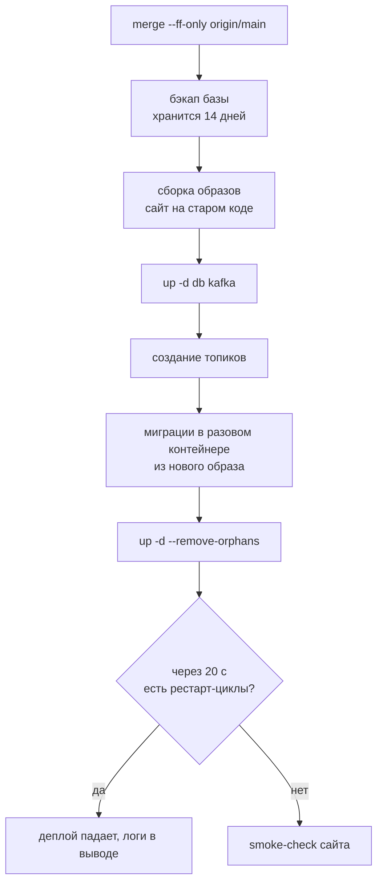

# 🔄 CI/CD

Пайплайн описан в `.github/workflows/ci.yml`. Проверки запускаются на push в `main` и `develop` и на каждый pull request;
деплой — только на push в `main`.

## Проверки

Выполняются по порядку, первая ошибка останавливает пайплайн:

| Шаг | Что проверяет |
|---|---|
| Pint | стиль кода |
| PHPStan (Larastan, уровень 6) | статический анализ app, config, database, routes, tests |
| PHPUnit | тесты на PostgreSQL 17 |
| `docker compose config` | корректность compose-файлов |
| ShellCheck | shell-скрипты в `docker/` |
| Docker build | образ собирается |
| Tailwind | в собранных стилях не осталось `@tailwind` |
| Gitleaks | в истории нет секретов |

Локально те же проверки: `composer lint`, `composer analyse`, `php artisan test`.

## Деплой

Деплой идёт на сервер по SSH. Секреты репозитория: `SSH_KEY`, `SSH_KNOWN_HOSTS`, `SSH_USER`, `SSH_HOST`, `SSH_PORT`.
Если в `.env` на сервере нет `COMPOSE_FILE`, деплой останавливается (подробности — в [мониторинге](monitoring.md)).
Сервер подготавливается Ansible: Docker, ufw, Tailscale, swap, SSH-ключи и шаблон `.env` с правами `0640` для группы `www-data`.

## Правила для миграций

Миграции выполняются, пока старая версия ещё обслуживает запросы, поэтому они **обратно совместимы**:
только новые таблицы и nullable-колонки. Новые права добавляются data-миграцией, потому что деплой запускает только `migrate`
(см. [Роли и права](../features/access.md)).
