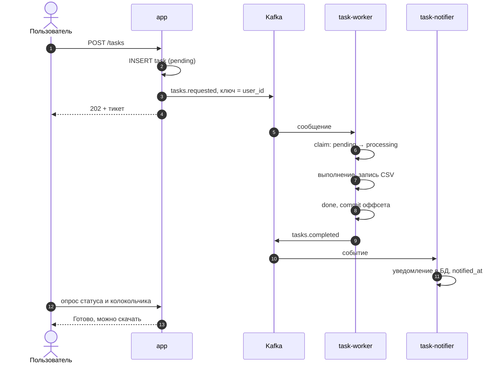
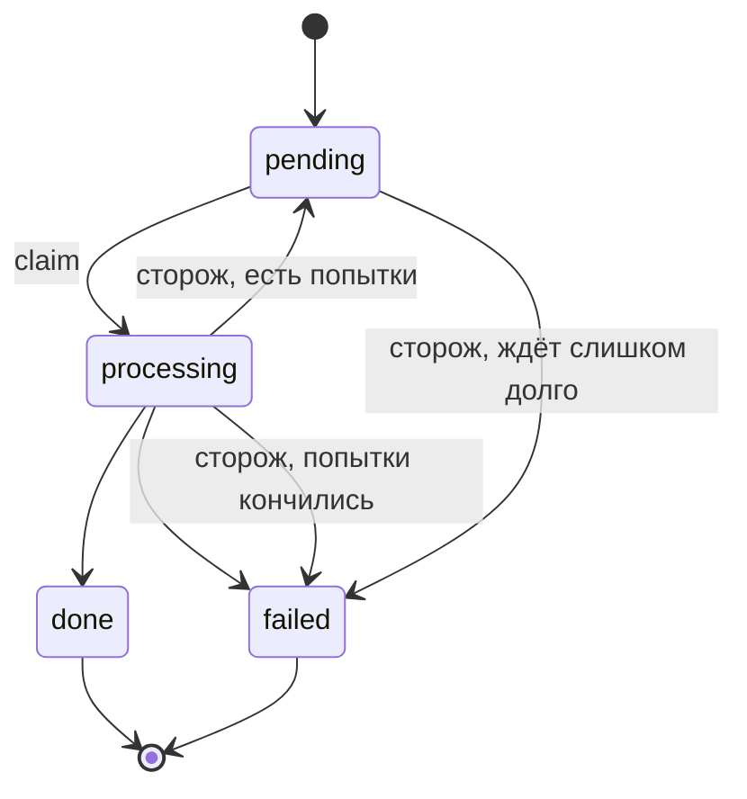

# 📨 Kafka

Kafka — шина событий. Веб-приложение не выполняет работу и не знает, кто её выполнит: оно записывает задачу
в базу и публикует событие. Каждый потребитель читает топик в своей consumer group,
поэтому новых подписчиков (письма, аналитика) можно добавлять, не трогая существующий код.

Пользовательская сторона описана в [Фоновых задачах](../features/background-tasks.md).

## Путь задачи



База — источник правды: сначала строка `tasks`, потом событие. Если публикация не удалась, запрос всё равно успешен,
а метка `published_at` остаётся пустой, и событие досылает сторож.

## Топики

| Топик | Партиции | Ключ | Пишет → читает |
|---|---|---|---|
| `tasks.requested` | 3 | `user_id` | app, scheduler → `task-worker` (группа `task-workers`) |
| `tasks.completed` | 1 | `user_id` | task-worker, scheduler → `task-notifier` (группа `notifier`) |
| `tasks.requested.dlq` | 1 | — | сообщения, которые не удалось разобрать (нет корректного `task_id`) |

Тело сообщения: `task_id` плюс `type` (запрос) или `status` и `finished_at` (завершение);
заголовок `schema-version: 1`. Ключ `user_id` гарантирует, что задачи одного пользователя идут по очереди,
а задачи разных пользователей выполняются параллельно. Воркеров больше трёх запускать бессмысленно: столько партиций.

Топики создаёт `docker/kafka/create-topics.sh` (идемпотентно, `--if-not-exists`), а не приложение:
автосоздание в брокере выключено.

## Статусы



## Гарантии доставки

- **At-least-once.** Оффсет коммитится только после обработки, поэтому при падении воркера сообщение придёт снова.
- **Идемпотентность воркера.** `claim()` — атомарный `UPDATE ... WHERE status = 'pending'`: повторное сообщение пропускается.
- **Идемпотентность нотификатора.** Метка `notified_at` ставится под блокировкой строки: повтор события второго уведомления не создаст.
- **Сторож** (`tasks:reconcile`, раз в минуту): публикует задачи без `published_at`, возвращает зависшие, переводит в `failed`
  исчерпавшие попытки и слишком долго ждавшие, повторно публикует невзятые и догоняет неотправленные события о завершении.
  После первой неудачной публикации останавливается: Kafka, скорее всего, недоступна.
- **Graceful shutdown.** На SIGTERM воркер доделывает текущую задачу (`stop_grace_period: 90s`).

## Брокер

| Параметр | Значение |
|---|---|
| Образ | `apache/kafka:4.1.0`, KRaft: брокер и контроллер в одном узле |
| Хранение сообщений | 168 часов, фактор репликации 1 |
| Память | heap 256 МБ, `mem_limit: 700m` |
| Порты наружу | **нет**: доступ только из docker-сети |
| Права на том `kafka-data` | выставляет `kafka-init` и завершается |

> 🔒 У Kafka нет аутентификации, поэтому публиковать её порт наружу нельзя.

## Переменные окружения

| Переменная | По умолчанию | Описание |
|---|---|---|
| `KAFKA_BROKERS` | `kafka:9092` | адрес брокера внутри docker-сети |
| `KAFKA_OFFSET_RESET` | `earliest` | откуда читать новой consumer group |

## Отладка

```bash
# список топиков
docker compose exec kafka /opt/kafka/bin/kafka-topics.sh --bootstrap-server localhost:9092 --list

# оффсеты и отставание группы воркеров
docker compose exec kafka /opt/kafka/bin/kafka-consumer-groups.sh \
  --bootstrap-server localhost:9092 --describe --group task-workers

# два воркера — увидеть ребаланс партиций
docker compose up -d --scale task-worker=2
```

Колонка `LAG` показывает, сколько сообщений ещё не обработано; ноль — воркеры успевают.
Ошибки `Name does not resolve` и `Connection refused` в логах воркера при перезапуске Kafka нормальны:
librdkafka переподключается сам. В тестах Kafka не используется: они работают через `Kafka::fake()`.
