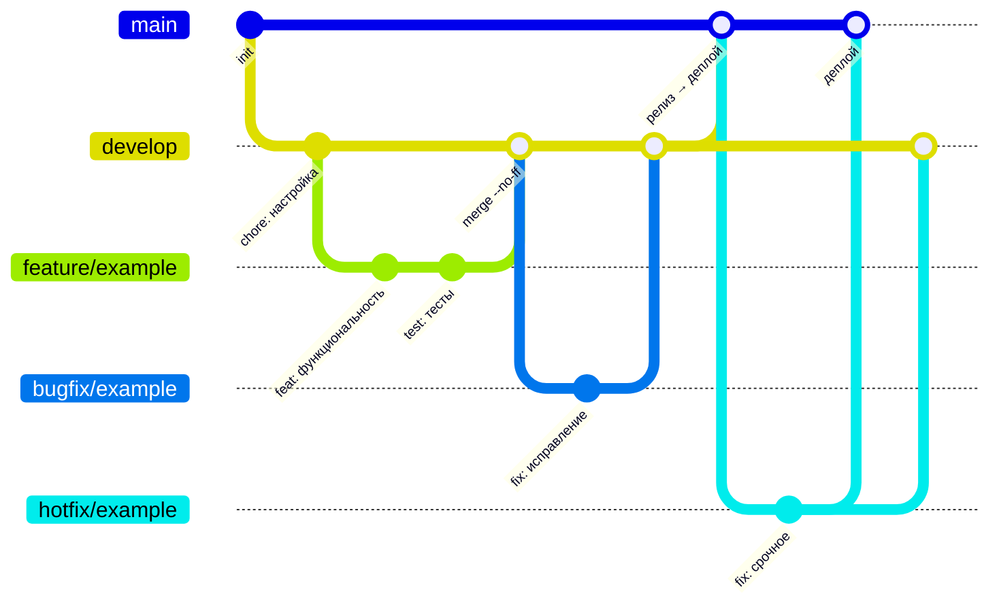

# 🛠️ Git-регламент: GitFlow, коммиты и командная работа

---

## 📚 Содержание

1. [Назначение](#-1-назначение)
2. [Правила написания коммитов](#-2-правила-написания-коммитов)
   2.1 [Типы коммитов](#-21-типы-коммитов-type) ·
   2.2 [Область изменений](#-22-область-изменений-scope) ·
   2.3 [Примеры](#-23-примеры-корректных-заголовков-коммитов) ·
   2.4 [Приведение коммитов к нужному виду](#-24-приведение-коммитов-к-нужному-виду)
3. [Работа с ветками и GitFlow](#-3-работа-с-ветками-и-gitflow)
   3.1 [Основные ветки](#-31-основные-ветки) ·
   3.2 [Поддерживающие ветки](#-32-поддерживающие-ветки) ·
   3.3 [Изолированные ветки](#-33-изолированные-ветки) ·
   3.4 [Именование](#-34-правила-именования-веток) ·
   3.5 [Слияние](#-35-слияние-веток) ·
   3.6 [Удаление](#-36-удаление-веток-после-завершения-работы) ·
   3.7 [Схема GitFlow](#-37-схема-gitflow) ·
   3.8 [Работа в команде](#-38-работа-с-ветками-в-команде)
4. [Запросы на слияние](#-4-запросы-на-слияние-веток-и-взаимодействие)
   4.1 [Чеклист](#-41-чеклист-перед-отправкой-pr--mr)
5. [Правила кода](#-5-правила-кода)

---

## 📌 1. Назначение

Документ содержит обязательные правила работы с Git в проекте и предназначен для всех, кто участвует в разработке.
Он описывает:
- стандарты написания коммитов;
- структуру и именование веток;
- стратегию GitFlow, адаптированную под проект;
- правила запросов на слияние;
- соглашения по коду, которые проверяют ревью и CI.

Выполнение правил даёт единообразие, уменьшает число конфликтов и сохраняет читаемую историю.

> ⚠️ Ознакомление с документом обязательно перед началом работы с кодовой базой.

---

## 🧾 2. Правила написания коммитов

Используется [соглашение о коммитах (Conventional Commits)](https://www.conventionalcommits.org/en/v1.0.0/). Описание пишется **на русском**.

```
<type>(<optional scope>): <description>

<optional body>

<optional footer(s)>
```

Заголовок: `<тип>(<область>): <описание>`.

Если изменения сложные, добавьте пояснение в **тело** коммита. Если задача оформлена в GitHub Issues,
укажите её номер в **футере**:

```
fix(orders): устранено двойное списание при повторной отправке заказа

Closes: #123
```

Допустимые метки футера:
- `Fixes: #123` — закроет задачу при слиянии;
- `Closes: #123` — аналогично `Fixes`;
- `Refs: #123` — ссылка без закрытия.

✅ Коммит должен быть:
- атомарным;
- в прошедшем времени (добавлен, реализован, устранена ошибка);
- в обезличенной форме (без «я», «сделал», «добавила»);
- по существу;
- без точки в конце заголовка;
- длиной заголовка ≤ 72 символов.

🚫 Не допускается:
- нецензурная лексика и сарказм;
- личные комментарии («вроде заработало», «наконец-то», «пускай будет»);
- отладочные остатки (`var_dump`, `dd`, `console.log`) и закомментированный код.


### 🔤 2.1. Типы коммитов (type)

- `build` — сборка проекта и внешние зависимости;
- `ci` — настройка CI/CD;
- `chore` — рутинные правки, не влияющие на функциональность и сборку: переименование файлов, `.gitignore`, уборка мусора;
- `docs` — документация (README, схемы, этот регламент);
- `feat` — новая функциональность;
- `fix` — исправление ошибок;
- `perf` — улучшение производительности;
- `refactor` — рефакторинг без исправления ошибок и новых возможностей;
- `revert` — откат предыдущего коммита;
- `style` — только оформление кода (отступы, форматирование);
- `test` — тесты.


### 🗺️ 2.2. Область изменений (scope)

Scope — логический модуль, где произошло изменение. Пишется в kebab-case, кратко и без пробелов.
Допустимы вложенность через `/` и уточнение через `:` — например, `ui/cart`, `db:migration`.

- Можно чётко назвать модуль → указываем.
- Изменение затрагивает один основной модуль → указываем его.
- Изменения «везде и понемногу» → scope можно опустить.

Словарь scope проекта:

| Scope | Область |
|---|---|
| `docker`, `compose` | `Dockerfile`, файлы compose |
| `nginx` | конфигурация nginx |
| `config` | конфигурация приложения (`config/`, `.env.example`) |
| `env` | переменные окружения |
| `ci` | GitHub Actions |
| `db` | схема и миграции |
| `kafka` | брокер, топики, скрипты |
| `tasks` | фоновые задачи, воркер, сторож |
| `notifications` | уведомления |
| `catalog` | каталог, сидер, дампы |
| `cart` | корзина |
| `pricing`, `promotions` | расчёт цен, акции |
| `orders`, `returns` | заказы, возвраты |
| `wallet`, `stock` | кошелёк, склад |
| `game` | «Утиная зорька» |
| `control-panel`, `users` | панель управления, пользователи и права |
| `ui` | интерфейс |
| `monitoring` | экспортеры и метрики |
| `readme` | README |

> Для `docs` и `test` scope можно опускать. Если он нужен, пусть будет содержательным:
> `docs(readme)`, `docs(workflow)`, `test(tasks)` — но не `docs(docs)` и не `test(tests)`.


### 📎 2.3. Примеры корректных заголовков коммитов

```
build(docker): исправлены ошибки в compose-файлах (nginx, порты, container_name)

ci: добавлена проверка утечек секретов

docs(readme): добавлена схема мониторинга

feat(returns): добавлен частичный возврат заказа
feat(promotions): добавлена бесплатная доставка от порога суммы

fix(tasks): обратный отсчёт до удаления результата застывал
fix(orders): устранено двойное списание при повторной отправке

perf(catalog): уменьшено число запросов на странице категории

refactor(pricing): расчёт цены вынесен в PriceCalculator

style: приведено к стандарту Pint

test(tasks): добавлены тесты конвейера задач
```


### ✏️ 2.4. Приведение коммитов к нужному виду

> ⚠️ `rebase -i` используйте только в личных feature-ветках. После rebase хеши коммитов меняются.

```bash
# переключиться на свою ветку
git switch <тип/название-ветки>

# обновить ссылки на удалённый репозиторий
git fetch origin

# интерактивно поправить сообщения и склеить коммиты (дата сохраняется)
git rebase -i --committer-date-is-author-date origin/develop
# reword — переименовать, squash/fixup — склеить, drop — удалить
# при конфликтах: исправить файлы → git add … → git rebase --continue
# пустой патч: git rebase --skip | отмена: git rebase --abort

# переписать удалённую ветку, не затирая чужие коммиты
git push --force-with-lease
```

Быстрая правка последнего коммита:

```bash
git commit --amend -m "type(scope): краткое описание"
```

---

## 🌿 3. Работа с ветками и GitFlow

> 💡 Проект использует кастомизированный GitFlow.

### 🔹 3.1. Основные ветки

| Ветка | Назначение |
|---|---|
| `main` | стабильная версия; каждый push автоматически выкатывается на сервер ([CI/CD](ci-cd.md)) |
| `develop` | основная ветка разработки, объединяет все изменения |


### 🔸 3.2. Поддерживающие ветки

| Ветка | Откуда создаётся | Куда мёржится | Назначение |
|---|---|---|---|
| `feature/*` | `develop` | `develop` | новая функциональность |
| `bugfix/*` | `develop` | `develop` | исправления до релиза |
| `release/*` | `develop` | `main` и `develop` | подготовка и стабилизация релиза |
| `hotfix/*` | `main` | `main` и `develop` | срочные исправления в продакшене |
| `docs/*` | `develop` | `develop` | изменения только документации (README, схемы, словарь) |


### 🪄 3.3. Изолированные ветки

| Ветка | Назначение |
|---|---|
| `orphan/*` | ветки без общей истории с кодом; хранят документацию, схемы и служебные файлы |

Сейчас такая ветка одна — `orphan/docs`, глубокая документация проекта.
Orphan-ветки не мёржатся и не участвуют в разработке приложения: это отдельное хранилище, которое не смешивается с кодовой базой.
Создаётся такая ветка через `git switch --orphan`; её история линейна.


### 🖊️ 3.4. Правила именования веток

Часть после префикса (`feature/`, `bugfix/`, `release/`, `hotfix/`, `docs/`) пишется в **kebab-case** и кратко отражает назначение.

- `feature/stock-report` — отчёт об остатках
- `bugfix/cart-total` — исправление расчёта корзины
- `docs/readme-update` — правка документации


### ⚠️ 3.5. Слияние веток

**Все слияния выполняются только через Pull Request (PR).**

При слиянии рабочих веток всегда делается явный merge, а не fast-forward: в истории остаётся информация,
что изменения шли в отдельной ветке. Для этого используется флаг `--no-ff`:

```bash
git merge --no-ff <тип/название-ветки>
```

Единственное исключение — сервер: он подтягивает `main` через `git merge --ff-only origin/main` при деплое.


### 🧹 3.6. Удаление веток после завершения работы

Удаляйте ветки после слияния, если доработка не требуется:

```bash
git branch -d <тип/название-ветки>
git push origin --delete <тип/название-ветки>
```

Если PR закрыт без слияния, ветка удаляется и локально, и на удалённом репозитории.


### 🔀 3.7. Схема GitFlow




### 👥 3.8. Работа с ветками в команде

Каждый ведёт работу в своей `feature/`-ветке. Прямой push в `develop` и `main` запрещён: всё идёт через PR.

**Перед созданием новой ветки** обновите локальную копию родительской (`develop` или `main`):

```bash
# 1) переключиться на локальный develop
git switch develop

# 2) обновить его строго fast-forward’ом
git pull --ff-only origin develop

# 3) создать новую ветку
git switch -c <тип/название-ветки>
```

> ❗ Если fast-forward невозможен («Not possible to fast-forward»), в локальном `develop` есть ваши коммиты.
> Сбросьте их:
> ```bash
> git fetch origin
> git reset --hard origin/develop
> ```

**Перед созданием PR** поставьте ветку поверх свежего `develop`, чтобы не было неожиданных конфликтов:

```bash
git fetch origin
git switch <тип/название-ветки>
git rebase origin/develop
git push --force-with-lease
```

> ⚠️ Rebase переписывает историю — только для личных feature-веток.

---

## 🛎️ 4. Запросы на слияние веток и взаимодействие

Один PR = одна задача. Название кратко отражает суть изменений.

В описании указываются:
- цель задачи;
- ключевые изменения;
- важные замечания (например, временные заглушки).

Заголовок PR пишется в прошедшем времени, в обезличенной форме и по существу.

### ✅ 4.1. Чеклист перед отправкой PR / MR

- [ ] Код протестирован локально
- [ ] `composer lint`, `composer analyse` и `php artisan test` проходят
- [ ] Удалён временный и отладочный код
- [ ] Коммиты приведены к нужному виду (см. [примеры](#-23-примеры-корректных-заголовков-коммитов) и [правку коммитов](#-24-приведение-коммитов-к-нужному-виду))
- [ ] Подтянута актуальная версия `develop`
- [ ] Новые миграции обратно совместимы, новые права добавлены data-миграцией
- [ ] Пройдено ревью (если требуется)

---

## 🧱 5. Правила кода

- **Комментарии** короткие (`// ...`), только там, где взаимодействие неочевидно: порядок блокировок,
  идемпотентность, причина обходного пути. Не пересказывайте имя метода, не используйте баннеры `----` и закомментированный код.
  Блоки `/** @param @return @var */` остаются там, где типы нужны PHPStan.
- **Тесты** сверяют ожидаемые значения, посчитанные вручную по спецификации, а не скопированные из текущего вывода.
- **Миграции** обратно совместимы (только новые таблицы и nullable-колонки): они выполняются, пока работает старая версия.
- **Язык**: комментарии, сообщения коммитов и тексты для пользователя — на русском.
