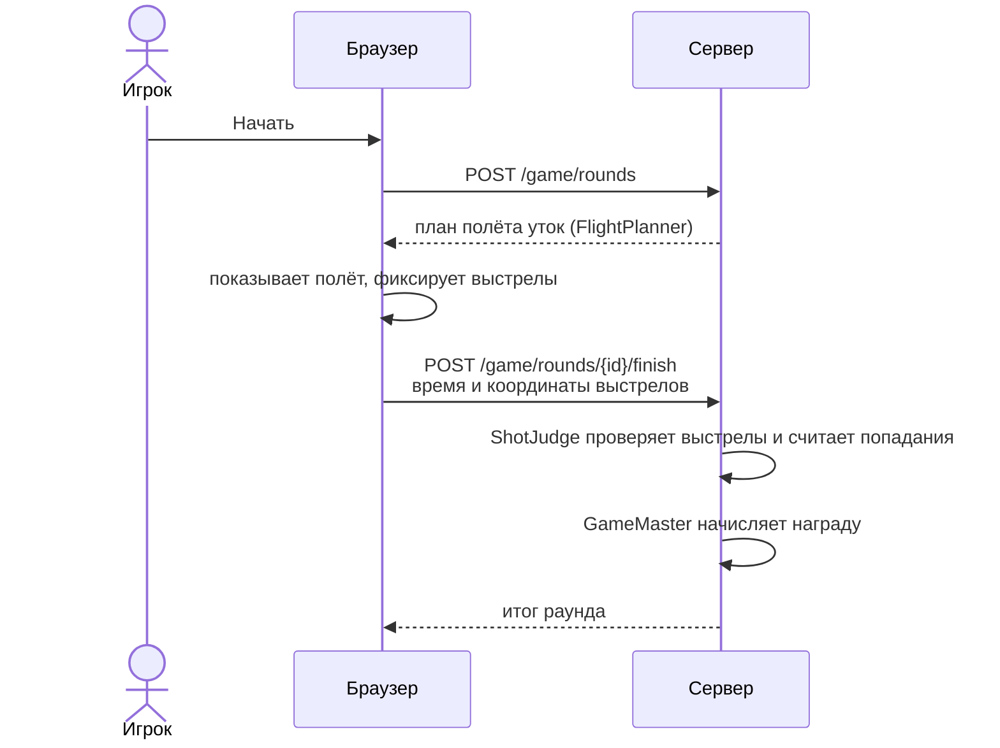

# 🦆 Утиная зорька

Мини-игра на странице `/game` (ссылка в меню под ником). Это единственный способ заработать рубли на [кошелёк](shop.md).
Результат раунда проверяет сервер: браузер ничего не решает.

## Ход раунда

- Сервер выдаёт план полёта: какие утки, откуда и с какой скоростью. Правила копируются в раунд при старте,
  поэтому смена настроек не влияет на идущие партии.
- От браузера принимаются только время и координаты выстрелов. Попадания считает сервер,
  а `ShotJudge` проверяет, что выстрелы выполнимы (интервал, магазин, перезарядка). Один выстрел поражает ближайшую из ещё не подбитых уток.
- Начать новый раунд можно, когда предыдущий не завершён: он помечается брошенным.

## Правила

| Параметр | Значение |
|---|---|
| Длительность раунда | 60 с |
| Уток в раунде | 14 |
| Магазин / перезарядка | 2 выстрела / 900 мс |
| Минимальный интервал между выстрелами | 120 мс |
| Цена очка | 25 ₽ |
| Суточный лимит награды | 3000 ₽ за скользящие 24 часа |

| Утка | Очки | Скорость | Доля в раскладке |
|---|---|---|---|
| Кряква | 1 | 230 | 65 |
| Чирок | 2 | 320 | 28 |
| Золотой селезень | 5 | 410 | 7 |

Скорость указана в условных единицах поля в секунду; размер поля — 960 × 540.

## Статусы раунда

| Статус | Когда |
|---|---|
| `playing` | идёт |
| `finished` | итог принят, награда начислена |
| `abandoned` | начат новый раунд, этот не закончен |
| `expired` | итог пришёл позже, чем через 120 с после расчётного конца |
| `rejected` | выстрелы не прошли проверку |

Итог принимается не раньше чем за 2 секунды до расчётного конца раунда (поправка на часы браузера).
Награда — очки × цена очка, но не больше остатка суточного лимита. Начисление идемпотентно: `reference = game:<id раунда>`.
Старт раунда ограничен 6 запросами в минуту и 90 в час на пользователя.
