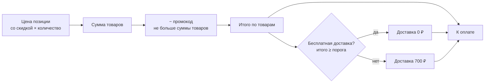

# 🏷 Цены и акции

Все цены считает один сервис — `Services/Pricing/PriceCalculator`. Корзина хранится в браузере
(`localStorage`), но на `POST /cart/quote` уходят только id и количество, а цены, скидки и порог
доставки возвращает сервер. Тот же расчёт повторён в геттерах `cart.js` только для отображения.

## Виды акций

| Вид | К чему применяется | Как срабатывает |
|---|---|---|
| Скидка в процентах | выбранные позиции | сама, пока акция действует |
| Промокод на сумму | вся стоимость товаров заказа | покупатель вводит код в корзине; можно ограничить число использований |
| Бесплатная доставка | заказ целиком | сумма заказа не меньше порога; из нескольких акций действует самый низкий порог |

Правила:

- На позицию действует **не больше одной** скидки (`product_id` в `promotion_product` уникален).
- Скидка округляется вниз, в пользу лавки; цена после скидки не меньше 1 ₽, процент — не больше 99.
- Промокод вычитается после скидок на позиции и не больше стоимости товаров.
- Промокод проверяется на существование, активность, срок и исчерпание лимита.
- Промокод хранится в сессии. Подбор кодов ограничен: 10 попыток в минуту и 60 в час с одного IP.

## Формула

Стоимость доставки — `shop.delivery_price` в `config/shop.php`. Максимальное количество одной позиции
в заказе — 999, и не больше остатка на складе.

## Управление

Акции заводятся в разделе «Акции» панели управления. Доступ определяется правами, а не ролью:
«Просмотр», «Создание», «Изменение» и «Удаление акций». По умолчанию они есть у администратора
и менеджера (см. [Роли и права](access.md)).

## Витрина и заказы

- Доска акций показывает действующие акции цветом мела, выбранным в форме. За 3 дня до конца
  таймер желтеет, в последние сутки надпись пульсирует и краснеет, в последний час мигает чаще.
- Цены и скидки копируются в `orders` и `order_items` на момент покупки. Счётчик использований
  промокода (`used_count`) растёт при оформлении заказа ([подробнее](shop.md)).
