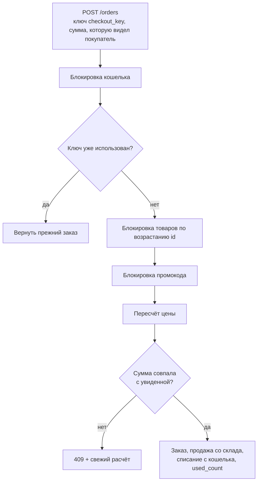

# 🛒 Склад, кошелёк, заказы и возвраты

Остатки и деньги меняются каждый только одним сервисом. Каждое изменение записывается в журнал,
а повтор той же операции ничего не меняет.

| Что | Сервис | Журнал |
|---|---|---|
| остаток товара | `Services/Stock/StockKeeper` | `stock_movements` |
| баланс кошелька | `Services/Wallet/WalletKeeper` | `wallet_transactions` |

## Склад

- Остаток не может стать отрицательным и не больше 1 000 000. Строка товара блокируется на время изменения,
  поэтому параллельные операции не затирают друг друга.
- Причины движения: поступление, инвентаризация (остаток ставится точным числом), продажа, возврат.
  В журнале хранятся изменение, остаток после, автор и примечание.
- Начальный остаток — 100 шт. Когда запас не больше `shop.low_stock` (10), карточка показывает «осталось мало»,
  на нуле — «нет в наличии».
- Остатки видит и меняет сотрудник с правами «Просмотр склада» и «Изменение остатков».
- Отчёт об остатках формируется фоновой задачей ([подробнее](background-tasks.md)).

## Кошелёк

- Каждому зарегистрированному выдаётся 20 000 ₽ (`shop.welcome_balance`). Для существующих пользователей
  подарок начислила data-миграция.
- Баланс не может быть отрицательным и не больше 100 000 000 ₽.
- У операции есть `reference` (например, `order:42`, `return:7`, `game:<uuid>`), уникальный в паре с кошельком:
  повтор вернёт прежнюю запись, а не спишет и не начислит второй раз.
- Ручного начисления нет. Деньги прибавляются только возвратом и [наградой в игре](game.md).

## Оформление заказа

`POST /orders` → `Services/Orders/OrderPlacer`. Всё происходит в одной транзакции.

- Блокировки берутся всегда в одном порядке (кошелёк → товары по id → промокод), и возвраты используют тот же порядок:
  так параллельные заказы не ловят взаимную блокировку.
- Если часть товаров закончилась, промокод перестал действовать или цена изменилась, заказ отклоняется с 409 и свежим расчётом.
- `orders.checkout_key` уникален в паре с пользователем, поэтому повторная отправка формы возвращает уже оформленный заказ.
- Оформление ограничено 10 запросами в минуту.

## Возвраты

В окне «Мои заказы» у оплаченного заказа есть «Оформить возврат» (`Services/Orders/OrderRefunder`).

- Срок — `shop.return_days` (14 дней) со дня покупки; возврат частичный, по строкам заказа.
- Причины: не подошёл, брак или поломка, не соответствует описанию, привезли не тот товар, передумал, другое.
- Деньги за товары делятся пропорционально стоимости строк нарастающим итогом от всех возвратов:
  сумма частичных возвратов равна оплаченному без ошибки округления. Доставка возвращается вместе с последним товаром.
- Остатки возвращаются на склад, деньги — на кошелёк. Если товар исчез при восстановлении каталога, деньги возвращаются всё равно.
- Статус заказа становится «Частичный возврат» или «Возвращён». Повтор запроса с тем же `return_key` безопасен.
